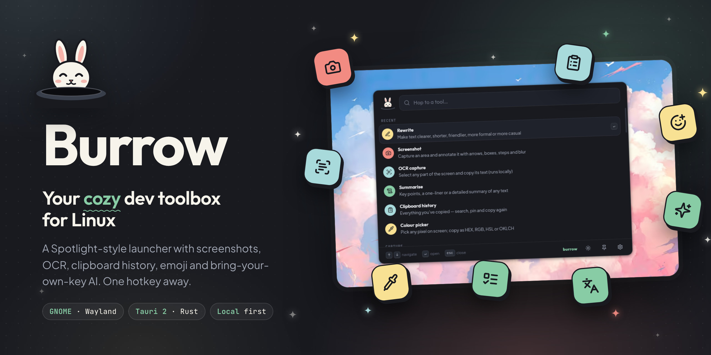

<p align="center">
  
</p>

<p align="center">
  
  
  
  
  
</p>

<p align="center">
  <a href="#install">Install</a> ·
  <a href="#tools">Tools</a> ·
  <a href="#settings">Settings</a> ·
  <a href="#getting-started">Getting started</a> ·
  <a href="#dependencies">Dependencies</a> ·
  <a href="#architecture">Architecture</a>
</p>

**Burrow** is a cozy burrow of developer utilities for Linux, one hotkey away. It lives in your tray:
press a hotkey, type a few letters, hit Enter. It also peeks at your clipboard and suggests the right
tool: copy JSON and it offers **Format JSON**, copy a JSON Schema and it offers **Mock data from schema**.

### Highlights

- **Screenshots without the fuss**: drag over any part of the screen, then copy, save or annotate
  (arrows, boxes, numbered steps, blur). Sharp on HiDPI, works across monitors.
- **OCR in one drag**: grab text from anything on screen, locally with Tesseract, in English or Bangla.
- **Clipboard history** that actually works on GNOME Wayland, with search, pins and secret filtering.
- **AI tools with your own key**: summarise, fix grammar, rewrite, translate, and turn rough notes into a
  natural Slack or WhatsApp message. OpenAI, Anthropic, OpenRouter, Ollama or any OpenAI-compatible API.
- **Everything at hand**: colour picker, emoji picker, tasks, quick notes and handy dev tools
  (JSON, schema mocks, SVG → JSX, ports, `.env` diff…).
- **Made for your desktop**: global hotkeys, a tray menu with your favourite tools, launcher / pinned /
  normal window modes, dark and light themes.

Built with **Tauri 2 + React 19 + TypeScript + Rust**. Your data stays on your computer; the only thing
that leaves it is what you send to the AI provider you chose, directly from Burrow.

---

## Install

Download the latest **`.deb`** from the [Releases page](https://github.com/JaberHPranto/burrow/releases/latest), then:

```bash
sudo apt install ./Burrow_*_amd64.deb
```

Open **Burrow** from your app grid (or run `burrow`), then set your hotkeys in **Settings → Hotkeys**.
Built for Ubuntu 22.04+ with GNOME. Some tools need small extra packages; the app tells you which,
and the [dependency list](#to-run-per-feature) has copy-ready commands.

To update, download the newer `.deb` and run the same command; your settings and notes are kept.

---

## Tools

### Capture

| Tool | What it does |
|---|---|
| **Screenshot** | Drag over any part of the screen (no dialog), then **Copy**, **Save** or **Annotate**: arrow, box, ellipse, highlight, pixelate, text, numbered steps, crop. Works across monitors and stays sharp on HiDPI |
| **OCR capture** | Drag over any text on screen and get it as text. Local Tesseract, English and Bangla |
| **Colour picker** | Pick any pixel on screen with GNOME's eyedropper → HEX, RGB, HSL, OKLCH; recent picks |

### Clipboard

| Tool | What it does |
|---|---|
| **Clipboard history** | Everything you've copied: search, pin, `Enter` to copy again. Skips secrets and password-manager copies ([how it works](#clipboard-history-on-gnome-wayland)) |
| **Emoji picker** | 1,900+ emoji by name, tag or `:shortcode:`; skin tones and recents. `Enter` copies and closes, `Shift+Enter` keeps it open; copy as shortcode or HTML entity too |

### Notes & tasks

| Tool | What it does |
|---|---|
| **Tasks** | Personal to-dos with quick add (`Review PR !high #work tomorrow`), Today / Upcoming / tag views |
| **Quick notes** | Scratchpad that saves as you type; pin and search |
| **Markdown viewer** | Split edit/preview, open `.md` files, copy as HTML |

### AI

Bring your own key: set up OpenAI, Anthropic, OpenRouter, Ollama or any OpenAI-compatible API in
[Settings → AI providers](#settings) and make one the default.

| Tool | What it does |
|---|---|
| **Summarise** | Key points, a one-liner or a detailed summary of any text |
| **Fix grammar** | Fixes spelling, grammar and punctuation; keeps your voice, language and formatting. Only mistakes, or mistakes + polish |
| **Rewrite** | Clearer, shorter, friendlier, more formal or more casual; “Use as input” to refine again |
| **Write a message** | Jot rough notes, get a natural, human-sounding message for a Slack channel, a WhatsApp group or a DM. Pick the tone, length and language (English, Bangla or Banglish) |
| **Translate** | Between English, Bangla and 16 other languages, natural or literal |

Each streams the reply as it's written (`Esc` stops it) and runs with `Ctrl+Enter`; all but Write a
message start with what's on your clipboard. Not happy with a message? **Retry** gives another take.
After OCR, **Ask AI** sends the text straight to Summarise or Translate.
Settings → Hotkeys can bind “fix grammar / summarise / translate the clipboard” or “write a message” to one key.
Requests go from Burrow directly to your provider; API keys stay in the system keyring and never reach the UI.

### Developer tools

| Tool | What it does |
|---|---|
| **JSON formatter** | Validate with line/column errors, prettify, minify, sort keys |
| **Schema → mock request** | Request bodies from JSON Schema, OpenAPI (pick an operation) or an example payload; output as JSON, cURL, fetch or HTTPie |
| **SVG optimizer → JSX** | SVGO + a typed React component |
| **Port inspector** | Who's listening on which port, with one-click stop |
| **.env diff** | Missing, empty and undocumented keys vs `.env.example` |
| **Password generator** | Crypto-secure, unbiased, with an entropy meter |
| **Lorem & fake data** | Paragraphs, people (JSON), names, emails, UUIDs |
| **Palette from image** | Paste, drop or open an image → palette as HEX, CSS variables or Tailwind |

**Clipboard suggestions.** When the launcher opens, Burrow looks at what you've copied and puts the
matching tool on top: JSON → JSON formatter, JSON Schema / OpenAPI → Schema mock, a colour (`#hex`,
`rgb()`, `hsl()`) → Colour picker, `<svg>` → SVG optimizer, `KEY=value` lines → .env diff,
Markdown → Markdown viewer, text in another script (Bangla…) →
Translate, a long article → Summarise. AI suggestions appear once a provider is set up. Turn suggestions
off in Settings → General.

**Tasks quick add:** `!high` `!med` `!low` (or `!1` `!2` `!3`, `!!!`), `#tag`, and a date:
`today`, `tomorrow`/`tmr`, a weekday (`fri`), `next week`, `in 3 days`, `in 2w`, `dec 5`, `2026-12-01`.

**Schema mock** understands `type`, `properties`/`required`, `items`, `enum`, `const`, `format`
(email, uuid, date-time, uri, …), string length, number ranges and `multipleOf`, `nullable`,
`allOf`/`oneOf`/`anyOf` and local `$ref`s. Field names steer values (`email`, `price`, `city`,
`createdAt`…), and an `email` next to a `name` matches it.

## Settings

Open it from the gear in the launcher footer, by searching “settings”, from the tray, or with `burrow --tool settings`.

| Section | What you can change |
|---|---|
| **General** | Start on login; window behaviour (**Launcher** hides when you click away, **Pinned** stays open and on top, **Normal** behaves like a regular window); clipboard suggestions |
| **Appearance** | Dark / light / follow the system; show or hide the bunny |
| **Tray** | Choose which tools appear in the tray menu for quick access (capture tools and “… clipboard” AI tools start right away) |
| **Hotkeys** | Record a global shortcut for the launcher, screenshot, OCR, colour picker, clipboard history, emoji picker, tasks, notes or settings. Burrow saves them as GNOME custom shortcuts, warns about clashes and refuses GNOME's own (`Ctrl+Alt+T`…) |
| **AI providers** | API keys for OpenAI, Anthropic, OpenRouter, Ollama or any OpenAI-compatible URL; default provider and model; “Test connection” lists the models. Keys live in the **system keyring** (GNOME Keyring), never in Burrow's files, and are never sent back to the UI |
| **Clipboard** | Record on/off, how many items to keep, skip secrets, install the background-recording extension |
| **Data** | Where data lives, export/import a JSON backup, reset. Backups don't include API keys |

### Clipboard history on GNOME Wayland

Wayland doesn't let apps watch the clipboard. Burrow ships a tiny GNOME Shell extension
(`burrow-clipboard@burrow.dev`, GNOME 42–49) that forwards each text copy to Burrow over D-Bus. It stores nothing
and makes no network calls; copies marked as coming from a password manager are dropped.
Install it from **Settings → Clipboard → Install extension**, then **log out and back in once**.
Without the extension, Burrow still records whatever is on the clipboard each time you open the launcher.

### Pinning the window

The pin button in every tool's header keeps Burrow open while you work in other windows.
GNOME on Wayland doesn't let apps put themselves on top, so the same extension does that part: it lets
Burrow ask GNOME Shell to keep its window above others. Without it, a pinned Burrow still stays open; press
`Alt+Space` on it and choose **Always on Top**. (On X11 sessions this works without the extension.)
If you installed the extension before pinning existed, Settings offers an **Update**, then log out and back in once.

### Opening in the centre

Wayland apps can't position their own windows either, so without the extension Burrow opens wherever GNOME
puts it (usually near the top-left). With the extension installed, Burrow opens in the middle of the monitor
your pointer is on, every time. Same rule: after an extension update, log out and back in once.

## Roadmap

| Phase | What | Notes |
|---|---|---|
| **1 ✅** | Launcher, clipboard suggestions, core dev tools | No special permissions needed |
| **2 ✅** | Screenshot + annotation editor, OCR, colour picker, tasks, schema mock | Silent capture via `gnome-screenshot` (portal fallback); OCR via local Tesseract |
| **3 ✅** | Settings, clipboard history, emoji picker | Clipboard history uses a small companion Shell extension |
| **4 ✅** | AI: summarise, fix grammar, rewrite, write a message, translate, OCR → AI | Bring your own key (OpenAI, Anthropic, OpenRouter, Ollama, OpenAI-compatible); streaming replies |
| **Next** | More AI tools (commit messages, regex, SQL), a chat with history | Each AI tool is a small preset over the shared view |

---

## Dependencies

Everything below is for **Ubuntu 22.04+ / GNOME**. Burrow checks the optional packages at startup:
a tool that's missing something shows a badge in the launcher (**red** = needed, **yellow** = works
better with it) and a banner inside the tool with a copy-ready install command and a **Re-check** button.

### To build and develop

| What | Why | Install |
|---|---|---|
| **Rust** (stable) | Compiles the native side | `curl --proto '=https' --tlsv1.2 -sSf https://sh.rustup.rs \| sh` |
| **Node.js 20+** | Frontend tooling (Vite, TypeScript) | via nvm / fnm / your package manager |
| **Tauri system libraries** | WebView, tray, icons, input | `sudo apt install libwebkit2gtk-4.1-dev build-essential curl wget file libxdo-dev libssl-dev libayatana-appindicator3-dev librsvg2-dev` |

### To run (per feature)

| Package | Used by | Needed? | What happens without it | Install |
|---|---|---|---|---|
| `libwebkit2gtk-4.1-0`, `libayatana-appindicator3-1` | The whole app | **Required** | Burrow won't start | Pulled in automatically by the `.deb` |
| GNOME **AppIndicator** extension | Tray icon & menu | Recommended | No tray icon (hotkeys still work) | Enabled by default on Ubuntu; else `gnome-extensions enable ubuntu-appindicators@ubuntu.com` |
| `gnome-screenshot` | Screenshot, OCR capture | Recommended | GNOME asks “Share this screenshot?” on every capture | `sudo apt install gnome-screenshot` |
| `xdg-desktop-portal-gnome` | Colour picker (and screenshot fallback) | **Required** for Colour picker | Can't pick colours from the screen | Installed by default on Ubuntu; else `sudo apt install xdg-desktop-portal-gnome` |
| `tesseract-ocr`, `tesseract-ocr-eng` | OCR capture | **Required** for OCR | OCR shows install instructions instead | `sudo apt install tesseract-ocr tesseract-ocr-eng` |
| `tesseract-ocr-ben` | OCR capture | Optional | No Bangla recognition (English still works) | `sudo apt install tesseract-ocr-ben` |
| `gsettings` (GNOME) | Settings → Hotkeys, `scripts/setup-gnome-shortcuts.sh` | For hotkeys | Can't register hotkeys | Part of GNOME |
| GNOME Keyring (Secret Service) | Settings → AI providers | For AI keys | Can't save API keys | Running by default on Ubuntu |
| Burrow GNOME extension | Clipboard history (background), keeping a pinned window on top | Optional | History only updates when you open the launcher; pinned windows stay open but not on top | Settings → Clipboard → Install |

The emoji picker uses the system emoji font (`fonts-noto-color-emoji`, installed by default on Ubuntu)
and hides emoji the font can't draw yet. Every other tool needs nothing beyond the app itself.

**Everything at once:**

```bash
sudo apt install gnome-screenshot xdg-desktop-portal-gnome tesseract-ocr tesseract-ocr-eng tesseract-ocr-ben
```

## Getting started

Install the [build dependencies](#to-build-and-develop) first (and any [runtime packages](#to-run-per-feature) for the tools you want).

### Run

```bash
npm install
npm run app:dev        # Tauri app with hot reload
```

Dev builds don't hide on blur, so devtools stay usable (right-click → Inspect).

**UI-only mode:** `npm run dev` and open http://localhost:1420 in a browser.
The platform layer swaps native calls for mock data, which is handy for styling work.

### Build & install from source

```bash
npm run app:build      # → src-tauri/target/release/bundle/deb/
sudo apt install ./src-tauri/target/release/bundle/deb/Burrow_*.deb
```

### Hotkeys

Wayland doesn't let apps grab global shortcuts, so GNOME runs Burrow's CLI instead. Set them in
**Settings → Hotkeys** (press the new combo), or apply the defaults below from a terminal:

```bash
scripts/setup-gnome-shortcuts.sh   # finds an installed burrow, or your dev build
```

| Shortcut | Action |
|---|---|
| `Ctrl` `Alt` `Space` | Toggle the launcher |
| `Ctrl` `Alt` `S` | Screenshot → annotate |
| `Ctrl` `Alt` `O` | Grab text (OCR) |
| `Ctrl` `Alt` `C` | Pick a colour |
| `Ctrl` `Alt` `N` | Quick notes |

Any tool can be bound: `burrow --tool <id>` (ids are the folder names in `src/tools/`).
Add `--run` to start its main action immediately (capture, pick).
The tray menu has the same quick actions.

Inside Burrow: `↑` `↓` to move, `Enter` to open, `Esc` to go back or close.

**Emoji picker keys:** arrows move · `Enter` copy & close · `Shift+Enter` copy & stay · `Tab` / `Shift+Tab` next / previous category.

**Clipboard history keys:** `↑` `↓` move · `Enter` copy & close · `Ctrl+P` pin · `Del` delete.

**Selection overlay keys:** drag to select · `Space` / double-click whole screen · `Tab` next monitor · `Enter` copy ·
`Ctrl+S` save · `E` annotate · `Esc` cancel.

**Screenshot editor keys:** `V` select/move · `A` arrow · `R` box · `E` ellipse · `H` highlight ·
`B` pixelate · `T` text · `N` numbered step · `C` crop · `Del` delete · `Ctrl+Z` / `Ctrl+Shift+Z` undo/redo ·
`Ctrl+C` copy image · `Ctrl+S` save.

---

## Architecture

```
src/
├── app/                 App shell + global store (route, recents)
├── core/
│   ├── tools/           Tool contract (types.ts) + registry (search, lookup)
│   ├── clipboard/       Clipboard → tool suggestions; clipboard history (logic + store)
│   ├── ai/              Provider resolution, presets, useAiStream, AiToolView (shared by AI tools)
│   ├── markdown/        Markdown → sanitised HTML (used by <Prose>)
│   ├── settings/        Settings shape + store, theme resolution, hotkey accelerators
│   ├── platform/        The ONLY place that talks to Tauri (commands, clipboard, events, mocks)
│   ├── storage/         Persistent key-value store + usePersistentState
│   ├── color/           Shared colour maths (parsing, conversion, OKLCH)
│   ├── fake/            Seeded fake-data primitives (shared by generator tools)
│   ├── handoff.ts       Pass data between tools (e.g. screenshot → OCR)
│   ├── search/          Fuzzy scorer
│   └── hooks/           Shared hooks (list navigation, image paste/drop)
├── design/              PawsDev design system: tokens, components, Bunny mascot
├── features/            Launcher, tool host, Settings screen (sections/ = one file per section)
└── tools/<id>/          One folder per tool — index.ts, logic.ts (+ test), View.tsx

src-tauri/src/
├── lib.rs               Plugins, command registration, setup
├── cli.rs               --toggle / --tool parsing
├── window.rs            Show / hide / toggle, open-tool events, blur guard
├── tray.rs              Tray menu
├── clipboard_bridge.rs  D-Bus service the Shell extension pushes copies to
└── commands/            capture (gnome-screenshot / portal, colour), ocr (tesseract), files (save dialogs),
                         ports (/proc), hotkeys (gsettings), ai (keyring + test), ai_stream (streaming
                         chat for OpenAI-compatible + Anthropic), clipboard (extension), app
src-tauri/extension/     The GNOME Shell extension (legacy 42–44 and ESM 45+ variants)
```

**Design rules**
- **Tools are plugins.** A tool is a folder plus one line in `src/tools/index.ts`. It's lazy-loaded, so the launcher stays instant.
- **Logic is pure and tested.** Every tool keeps its behaviour in `logic.ts` with a Vitest suite; views stay thin.
- **One door to native.** Tools never call `invoke` directly; they use `core/platform/commands.ts`, which also provides browser mocks.
- **Design tokens only.** Colours, type and spacing come from `design/tokens.css`. No raw hex in components.
- **Least privilege.** Tauri capabilities list only what's used; Rust commands validate their inputs.

See [CLAUDE.md](CLAUDE.md) for conventions and a step-by-step "add a tool" guide.

## Scripts

| Command | |
|---|---|
| `npm run app:dev` | Run the desktop app |
| `npm run app:build` | Build the `.deb` (in `src-tauri/target/release/bundle/deb/`) |
| `npm run dev` | UI only, in the browser with mocks |
| `npm run check` | Typecheck + lint + tests |
| `npm test` | Vitest |
| `npm run lint:fix` | Biome format + autofix |
| `cd src-tauri && cargo test` | Rust tests |
| `cd src-tauri && cargo clippy --all-targets -- -D warnings` | Rust lint |

## Design

PawsDev palette: mint `#88CCA6`, butter `#F8E192`, aqua `#A8DADC`, coral `#F28B82`
on ink `#181A20`. Type: Outfit (display), Plus Jakarta Sans (body), JetBrains Mono (labels and code).
Dark is the default. The light theme uses the hand-drawn look: ink outlines and offset shadows.
The window is a rounded card with a soft shadow, so it stands out from whatever is behind it.
